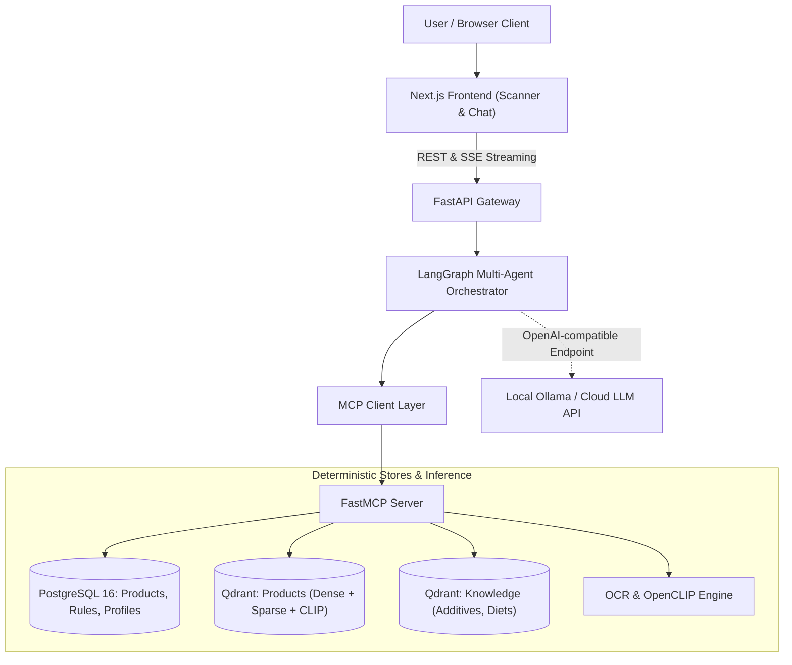
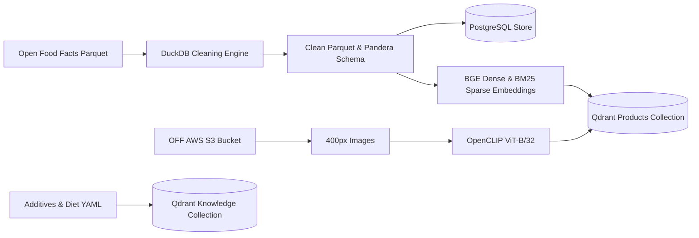

# LabelLens: Nutrition & Food Label Analyzer

> **LabelLens** is an open-source, multimodal, agentic food label and nutrition analysis platform. It identifies products via barcodes, packaging photos, or names, explains additives and ingredients with grounded evidence, verifies strict dietary and allergen constraints with deterministic rule engines, and exposes all capabilities through standard Model Context Protocol (MCP) tools.

---

## 1. Architecture Overview

### 1.1 Online Inference Architecture



### 1.2 Offline Data & Embedding Pipeline



### Core Design Principles
1. **Deterministic first, LLM second:** Barcode lookups, allergen matching, and diet verdicts are computed with strict SQL and rule engines, never LLM guessing. The LLM only explains and orchestrates.
2. **Provider-agnostic LLM:** Unified OpenAI-compatible interface; model and endpoint configured via environment variables (`LLM_MODEL`, `LLM_BASE_URL`).
3. **Everything through MCP tools:** The same tools serve internal LangGraph agents, the FastAPI gateway, and external MCP clients (such as Claude Desktop).
4. **Privacy-first profile:** Dietary preferences and allergen lists are stored client-side in the browser, not saved on external servers.

---

## 2. Project Roadmap & Implementation Status


### Phase Progress Checklist
- [x] **Phase 0: Project Setup** — `uv`, Python 3.12, Docker Compose (PostgreSQL 16 & Qdrant), healthchecks, CI quality tooling, Ollama smoke test.
- [x] **Phase 1: Download & Understand Data** — Open Food Facts bulk Parquet ingestion, in-place DuckDB exploration, subset filtration rules.
- [x] **Phase 2: Cleaning & Normalization** — GS1 barcode checksum validation, Pandera schema enforcement, data quality profiling, `products.parquet` generated.
- [x] **Phase 3: Structured PostgreSQL Store** — SQLAlchemy 2 declarative models, Alembic migrations, high-throughput streaming COPY loader, pg_trgm fuzzy search indexes.
- [x] **Phase 4: Embeddings & Vector Database** — Qdrant dual-collection setup (`products` & `knowledge`), BGE dense text embeddings, FastEmbed BM25 sparse vectors, OpenCLIP image vectors, HNSW tuning, INT8 scalar quantization benchmarks.
- [x] **Phase 5: Hybrid & Multimodal Retrieval** — Reciprocal Rank Fusion (RRF), cross-encoder reranking (`BAAI/bge-reranker-base`), multimodal query router, golden set ablation benchmarks.
- [x] **Phase 6: Agents with LangGraph** — Stateful multi-agent graph (router, candidates finder, interactive interrupt picker, parallel ingredient/additive/diet analysts, bounded revision critic, and template fallbacks).
- [ ] **Phase 7: FastMCP Server** — Standard Model Context Protocol server exposing tools, resources, and prompt templates.
- [ ] **Phase 8: API Gateway with FastAPI** — Async API, Server-Sent Events (SSE) streaming chat responses, Pydantic v2 schemas.
- [ ] **Phase 9: Frontend with Next.js** — Mobile-first web application with in-browser camera barcode scanning and streaming chat.
- [ ] **Phase 10: Formal Evaluation** — Golden evaluation datasets for allergen detection, retrieval Recall/MRR, and multi-agent tracing.
- [ ] **Phase 11: Production Hardening & Cloud Deployment** — Multi-stage Docker packaging, GitHub Container Registry, cloud deployment on free tiers.

### Phase 6 Agent & Safety Invariant Evaluation

| Test Suite / Eval | Scope | Result | Details |
|---|---|:---:|---|
| **Deterministic Rule Tests** (`test_rules.py`) | Allergen & diet logic, 3-valued status, FSA traffic lights | **10/10 Passed** | 100% agreement with safety invariants |
| **Structured LLM Validation** (`test_structured.py`) | Pydantic JSON validation, repair loop, format fallbacks | **3/3 Passed** | Tolerates thinking blocks & malformed JSON |
| **Graph & Interrupt Tests** (`test_graph.py`) | Barcode routing, fake LLM analysts, human-in-the-loop pause/resume | **3/3 Passed** | Verified state persistence & memory saver |
| **Invariant Sampling Eval** (`run_agent_eval.py`) | 50 sampled products against randomized diets & allergens | **50/50 Passed (100%)** | Zero undeclared allergen or diet false positives |
| **End-to-End Suite** (`pytest tests`) | Full project test suite (Phases 0–6) | **64/64 Passed** | Clean integration across repositories, embeddings, and agents |

### Phase 5 Retrieval Benchmark Results (Golden Set: 120 Queries)

| Retrieval Pipeline | Recall@1 | Recall@5 | Recall@10 | MRR | Avg Latency (ms) |
|---|:---:|:---:|:---:|:---:|:---:|
| **1. Dense Only (BGE)** | 0.608 | 0.775 | 0.808 | 0.681 | 27.2 ms |
| **2. Sparse Only (BM25)** | 0.658 | 0.808 | 0.858 | 0.723 | 10.9 ms |
| **3. Hybrid RRF (Dense + BM25)** | 0.658 | 0.808 | 0.850 | 0.730 | 30.2 ms |
| **4. Hybrid RRF + Cross-Encoder Reranker** | **0.667** | **0.808** | **0.858** | **0.736** | 195.8 ms |

*See [`docs/retrieval_results.md`](docs/retrieval_results.md) for detailed ablation analysis.*

---

## 3. Requirements

- **Operating System:** Windows 10/11 (WSL2), Linux, or macOS
- **Python:** 3.12 (managed via `uv`)
- **Docker & Docker Compose:** Docker Engine 24+ / Compose v2
- **Node.js:** 20+ LTS (for Next.js frontend)
- **Local LLM:** Ollama (default: `qwen2.5:7b` or `qwen2.5:3b`)

---

## 4. Quick Start

### 1. Clone & Set Up Python Environment
```bash
# Clone the repository
git clone https://github.com/iar01/nutrition-and-food-label-analyzer.git
cd nutrition-and-food-label-analyzer

# Create virtual environment with Python 3.12 and install dependencies
uv venv --python 3.12 .venv
.venv\Scripts\activate      # On Windows
# source .venv/bin/activate # On Linux/macOS

# Install development package
uv pip install -e ".[dev]"
```

### 2. Configure Environment
```bash
cp .env.example .env
```
Inspect `.env` and verify database, vector store, and LLM connection settings.

### 3. Start Infrastructure (Postgres & Qdrant)
```bash
docker compose up -d
```
Verify container health:
```bash
docker compose ps
```
- PostgreSQL 16: `localhost:5432`
- Qdrant Vector Store: `localhost:6333` (HTTP) / `localhost:6334` (gRPC)

### 4. Run Ollama & LLM Smoke Test
Make sure Ollama is running and has pulled the model:
```bash
ollama run qwen2.5:7b
```
Run the smoke test:
```bash
pytest -m smoke tests/test_smoke_llm.py
```

### 5. Run All Quality Checks
```bash
# Linting & Formatting
ruff check .
ruff format --check .

# Type checking
mypy packages

# Unit tests
pytest -m "not smoke"
```

---

## 5. Project Layout

```text
nutrition-and-food-label-analyzer/
├── apps/
│   ├── api/            # FastAPI gateway
│   ├── mcp_server/     # FastMCP server
│   └── web/            # Next.js frontend
├── packages/labellens/ # Shared Python package
│   ├── config.py       # Pydantic Settings configuration
│   ├── data/           # Extraction, cleaning, DuckDB loader
│   ├── embeddings/     # Text (BGE), Image (CLIP), Sparse (BM25)
│   ├── retrieval/      # Qdrant hybrid retrieval & rerankers
│   ├── agents/         # LangGraph state machine & analyst nodes
│   ├── db/             # SQLAlchemy 2 models & Alembic migrations
│   └── llm/            # OpenAI-compatible provider abstraction
├── data/               # Gitignored data storage: raw/ interim/ clean/ images/
├── notebooks/          # Exploratory data analysis & experiments
├── evals/              # Golden eval sets and metric scripts
├── infra/              # Dockerfiles, CI workflows, deployment manifests
├── docs/               # Data dictionary, design documentation
├── tests/              # Unit, integration, and smoke tests
├── pyproject.toml      # Build and dependency definition (uv)
├── docker-compose.yml  # Local Postgres & Qdrant infrastructure
├── .env.example        # Environment variable template
└── README.md
```

---

## 6. Data & Attribution

- **Source:** Open Food Facts (`openfoodfacts/product-database`)
- **License:** Open Database License (ODbL) for product data; CC BY-SA for packaging images.
- **Attribution:** Data sourced with appreciation from the global Open Food Facts community.

---

## 7. Disclaimer

LabelLens is an educational and informational tool. **It does not provide medical or clinical nutritional advice.** Always consult healthcare professionals for acute dietary and severe allergic conditions.

---

## 8. License

Code is licensed under the [MIT License](LICENSE).
