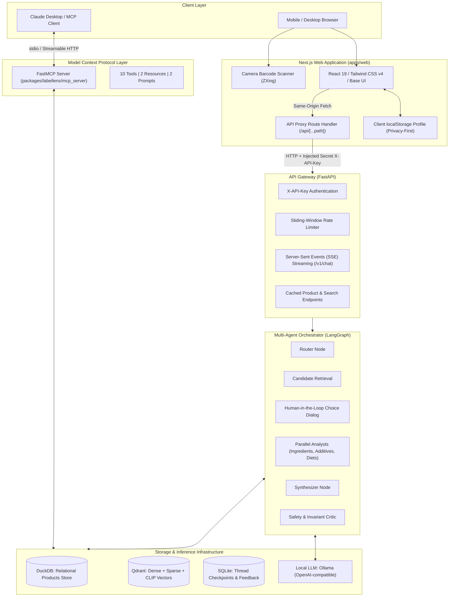
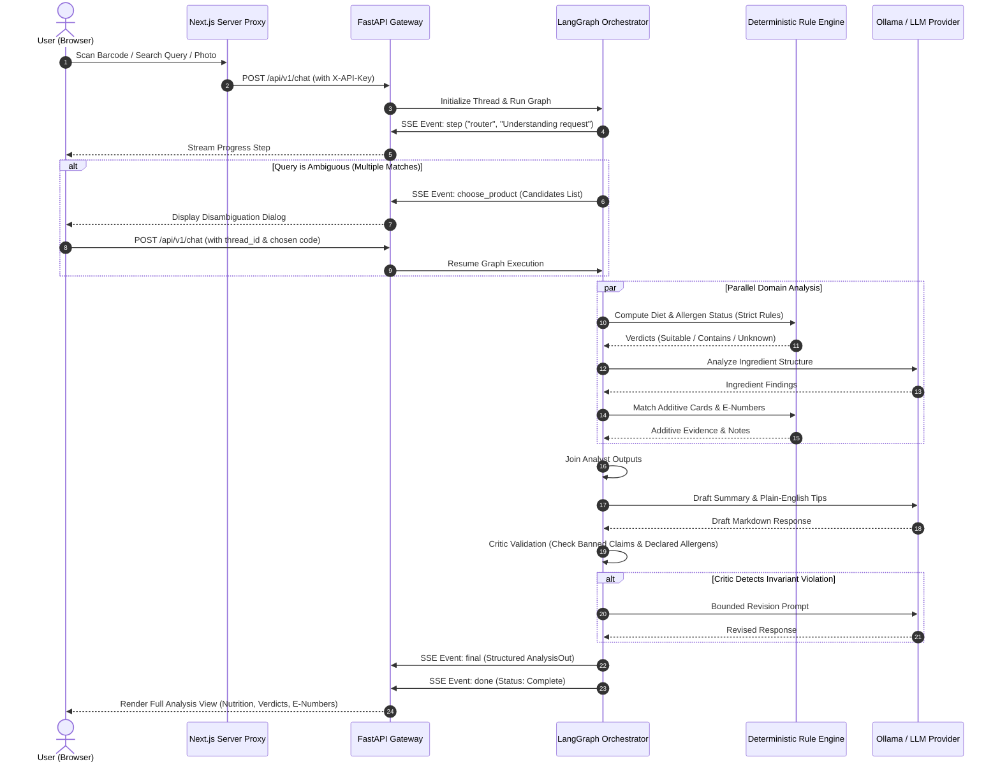

# LabelLens: Nutrition & Food Label Analyzer

> **LabelLens** is an open-source, multimodal food label and nutrition analysis platform. It identifies packaged food products via barcode scans, ingredient list photos, or text search; extracts and explains additives and E-numbers with grounded evidence; verifies strict dietary and allergen constraints using deterministic rule engines; orchestrates multi-agent reasoning through LangGraph; and surfaces capabilities via a mobile-first Next.js web application and standard Model Context Protocol (MCP) tools.

---

## 1. Project Introduction

Packaged food labels are deliberately hard to navigate: dense ingredient lists, obscure chemical additive numbers (E-numbers), ambiguous allergen warnings, and misleading marketing claims. Consumers with life-threatening allergies, strict dietary commitments (vegan, vegetarian, gluten-free, lactose-free, nut-free, palm-oil-free), or specific nutritional goals need immediate, trustworthy, and verifiable answers in a supermarket aisle.

LabelLens solves this with three core capabilities:

1. **Deterministic-First Analysis:** Barcode lookups, allergen matching, and dietary compliance are computed strictly via deterministic SQL indexes and rule engines—never probabilistic LLM guesswork. The LLM only explains and synthesizes evidence.
2. **Multimodal Agentic Orchestration:** A stateful LangGraph multi-agent pipeline routes queries, performs parallel ingredient, additive, and diet analyses, resolves ambiguous product matches through human-in-the-loop choice dialogs, and validates output safety with a bounded revision critic.
3. **Dual-Surface Access (Web & MCP):** A mobile-first Next.js web application provides in-browser camera barcode scanning and streaming analysis, while a standard FastMCP server enables direct integration with external MCP clients such as Claude Desktop.

---

## 2. Architecture Overview

LabelLens separates offline data transformation from online reactive inference:



### Core Components and Responsibilities

- **Next.js Web Client (`apps/web`):** Built with Next.js 16 (App Router, Turbopack) and Tailwind CSS v4. Features client-side barcode scanning (`@zxing/browser`) with GS1 check digit validation, camera orientation constraints, client-side photo resizing with HTML5 Canvas (stripping EXIF metadata), and zero-leakage proxy routing.
- **FastAPI Gateway (`packages/labellens/api`):** Asynchronous gateway providing request validation (Pydantic v2), constant-time API key verification, sliding-window rate limiting, and real-time SSE event streaming (`step`, `choose_product`, `final`, `done`).
- **LangGraph Agent Engine (`packages/labellens/agents`):** Stateful cyclical graph managing query classification, product retrieval, parallel analyst execution, interactive disambiguation interrupts, and critique loops.
- **FastMCP Server (`packages/labellens/mcp_server`):** Exposes 10 read-only deterministic and multimodal inspection tools over `stdio` and streamable HTTP transports.
- **Hybrid Retrieval System (`packages/labellens/retrieval`):** Combines dense vector search (`BAAI/bge-small-en-v1.5`), sparse BM25 lexical search (`FastEmbed`), OpenCLIP visual embedding (`ViT-B-32`), Reciprocal Rank Fusion (RRF), and cross-encoder reranking (`BAAI/bge-reranker-base`).
- **Data Persistence:** DuckDB provides millisecond-latency analytical lookups; Qdrant handles multi-vector similarity; SQLite manages conversation state checkpoints and user feedback.

---

## 3. Execution Lifecycle & Workflows

### 3.1 Online Request Lifecycle



### 3.2 Offline Data Preparation Pipeline

```mermaid
flowchart LR
    OFF["Open Food Facts Bulk Parquet (food.parquet)"] --> InPlaceDuckDB["DuckDB In-Place Extraction (data/extract.py)"]
    InPlaceDuckDB --> Interim["Interim Parquet (completeness >= 0.5)"]
    Interim --> CleaningPipeline["Cleaning Pipeline (data/pipeline.py)"]
    CleaningPipeline --> GS1Check["GS1 Checksum Filter & Deduplication"]
    GS1Check --> Pandera["Pandera Schema Validation"]
    Pandera --> CleanParquet["Clean Parquet (data/clean/products.parquet)"]
    
    CleanParquet --> BuildDuckDB["Build DuckDB Store (scripts/build_product_db.py)"]
    CleanParquet --> DenseSparse["BGE Dense + BM25 Sparse Indexing (scripts/index_products.py)"]
    
    YAML["Additive & Diet Knowledge YAML (docs/knowledge/)"] --> IndexKnowledge["Chunk & Index Knowledge (scripts/index_knowledge.py)"]
    
    CleanParquet --> DownloadImages["Download 400px Images (scripts/download_images.py)"]
    DownloadImages --> ClipEmbed["OpenCLIP ViT-B/32 (scripts/embed_images.py)"]
    ClipEmbed --> AttachVectors["Attach Image Vectors (scripts/attach_image_vectors.py)"]

    BuildDuckDB --> ProductDB[("products.duckdb")]
    DenseSparse --> QdrantProducts[("Qdrant: products")]
    IndexKnowledge --> QdrantKnowledge[("Qdrant: knowledge")]
    AttachVectors --> QdrantProducts
```



---

## 4. Technology Stack

### Languages & Frameworks
- **Python:** 3.12 (managed via `uv`)
- **Node.js:** 20+ LTS / TypeScript 5.x
- **Backend API:** FastAPI 0.143+, Uvicorn 0.54+, Pydantic v2.7+, Pydantic Settings
- **Frontend App:** Next.js 16.4 (App Router, Turbopack), React 19, Tailwind CSS v4, Base UI, shadcn/ui

### Agents & MCP
- **Agent Orchestrator:** LangGraph 0.2+, LangChain Core 0.3+, LangChain OpenAI
- **Checkpointer:** `langgraph-checkpoint-sqlite` 3.1+
- **Model Context Protocol:** FastMCP 4.1+, `langchain-mcp-adapters` 0.3+

### AI, Machine Learning & Vision
- **LLM Engine:** Ollama (default: `qwen2.5:7b` or `qwen2.5:3b`) via OpenAI-compatible API
- **Dense Embeddings:** `BAAI/bge-small-en-v1.5` via `sentence-transformers` 6.1+
- **Sparse Embeddings:** `Qdrant/bm25` via `fastembed` 0.9+
- **Image Embeddings:** `ViT-B-32` (`openai` weights) via `open-clip-torch` 3.3+ and PyTorch
- **Reranker:** `BAAI/bge-reranker-base` via `sentence-transformers`
- **OCR Engine:** EasyOCR 1.7+ (PyTorch backend)

### Data Processing & Storage
- **Analytical DB:** DuckDB 1.0+
- **Vector DB:** Qdrant 1.9+ (named dense, sparse, and image vectors with payload filters)
- **Relational DB:** PostgreSQL 16 (SQLAlchemy 2.0, Alembic, asyncpg, psycopg)
- **Data Validation:** Pandera 0.19+, PyArrow 15.0+, Pandas 2.2+

### Testing & Tooling
- **Unit & Integration:** Pytest 8.0+, `pytest-asyncio`, HTTPX 0.27+
- **E2E Testing:** Playwright 1.64+ (Desktop Chrome & Pixel 7 Mobile emulation)
- **Linters & Typers:** Ruff 0.4+, Mypy 1.10+, ESLint 9+

---

## 5. Prerequisites

Before installing LabelLens, verify that your environment satisfies:

- **Operating System:** Windows 10/11 (PowerShell / WSL2), Ubuntu/Debian Linux, or macOS.
- **Python:** Version 3.12.x.
- **`uv` Package Manager:** Fast Python package and environment manager ([Install uv](https://docs.astral.sh/uv/getting-started/installation/)).
- **Node.js & npm:** Node.js 20+ LTS and npm 10+.
- **Docker & Docker Compose:** Docker Engine 24+ and Docker Compose v2 (to run Qdrant and PostgreSQL).
- **Ollama:** Local LLM runner installed ([ollama.com](https://ollama.com)) with at least 8 GB of system RAM for running `qwen2.5:7b` or `qwen2.5:3b`.

---

## 6. Installation and Setup

### Step 1: Clone the Repository
```bash
git clone https://github.com/iar01/nutrition-and-food-label-analyzer.git
cd nutrition-and-food-label-analyzer
```

### Step 2: Set Up Python Virtual Environment
Using `uv`:

**Windows PowerShell:**
```powershell
uv venv --python 3.12 .venv
.venv\Scripts\activate
uv pip install -e ".[dev]"
```

**Linux / macOS:**
```bash
uv venv --python 3.12 .venv
source .venv/bin/activate
uv pip install -e ".[dev]"
```

### Step 3: Install Frontend Dependencies
```bash
cd apps/web
npm install
cd ../..
```

### Step 4: Configure Environment Files

#### 1. Generate a Secure API Key
LabelLens uses token authentication between the Next.js frontend proxy and the FastAPI gateway via the `X-API-Key` request header. You can generate a cryptographically secure random token with any standard utility:

```bash
# Using Python (cross-platform, recommended):
python -c "import secrets; print(secrets.token_urlsafe(32))"

# Or using OpenSSL (Linux / macOS / Git Bash):
openssl rand -hex 32
```

> [!IMPORTANT]
> **Security Notice:** Never hardcode or commit actual API keys or secrets to Git. Placeholders like `your_generated_api_key_here` are used throughout documentation. Real keys belong exclusively in `.env` and `apps/web/.env.local`, both of which are ignored by `.gitignore`.

#### 2. Root Backend Configuration (`.env`)
Copy `.env.example` to `.env`:
```bash
cp .env.example .env
```
Open `.env` and assign your generated token to `API_KEYS`:
```ini
APP_ENV=development
API_KEYS=your_generated_api_key_here
LLM_BASE_URL=http://127.0.0.1:11434/v1
LLM_MODEL=qwen2.5:7b
QDRANT_URL=http://localhost:6333
```
*(To support multiple authorized clients or development keys, provide a comma-separated list: `API_KEYS=key1,key2`)*.

#### 3. Frontend Configuration (`apps/web/.env.local`)
Copy `apps/web/.env.example` to `apps/web/.env.local`:
```bash
cp apps/web/.env.example apps/web/.env.local
```
Set `LABELLENS_API_KEY` to the **exact same key** you assigned in `API_KEYS`:
```ini
LABELLENS_API_URL=http://127.0.0.1:8000
LABELLENS_API_KEY=your_generated_api_key_here
```

### Step 5: Start Infrastructure Containers
Launch PostgreSQL 16 and Qdrant:
```bash
docker compose up -d
```
Verify container health:
```bash
docker compose ps
```
- PostgreSQL: `localhost:5432`
- Qdrant Vector DB: `localhost:6333` (HTTP) / `localhost:6334` (gRPC)

---

## 7. Data Acquisition and Preparation

LabelLens operates on structured data from [Open Food Facts](https://world.openfoodfacts.org). To populate the analytical store and vector collections, follow this reproducible sequence:

### 1. Download Open Food Facts Data
Place the Open Food Facts bulk Parquet export into `data/raw/food.parquet`. The data can be downloaded directly from the official Open Food Facts data repository or Hugging Face datasets:
```bash
# Ensure directory exists
mkdir -p data/raw

# Download monthly export (example using curl or wget)
curl -L -o data/raw/food.parquet "https://openfoodfacts-data.s3.eu-west-3.amazonaws.com/data/openfoodfacts-products.parquet"
```

### 2. Extract, Clean, and Validate
Run the DuckDB in-place extraction and Pandera cleaning pipeline. This validates GS1 check digits, removes duplicate entries, normalizes text, and derives diet suitability flags without loading the entire raw file into memory:
```bash
uv run python -c "from labellens.data.pipeline import clean_and_normalize_dataset; clean_and_normalize_dataset()"
```
*Output: Generates validated `data/clean/products.parquet` and `docs/data_quality_report.md`.*

### 3. Build DuckDB Analytical Store
Build the fast local DuckDB index used by the API and agent graph for millisecond barcode lookups:
```bash
uv run python scripts/build_product_db.py
```
*Output: Generates `data/interim/products.duckdb` with unique index `idx_products_code`.*

### 4. Initialize Qdrant Collections
Initialize the Qdrant collections with dense, sparse, and CLIP vector configurations:
```bash
uv run python scripts/setup_qdrant.py
```
*Output: Creates `products` and `knowledge` collections in Qdrant.*

### 5. Index Knowledge Cards (Additives & Diets)
Chunk and index the authoritative additive explanations and diet definition cards from `docs/knowledge/`:
```bash
uv run python scripts/index_knowledge.py
```

### 6. Embed and Index Products
Generate dense BGE embeddings and BM25 sparse vectors for all products in the clean dataset:
```bash
uv run python scripts/index_products.py
```

### 7. (Optional) Multimodal Packaging Images
To enable packaging image search and CLIP vector indexing:
```bash
# 1. Download packaging image samples (front 400px images)
uv run python scripts/download_images.py --limit 1000

# 2. Compute OpenCLIP ViT-B/32 image embeddings
uv run python scripts/embed_images.py

# 3. Attach image vectors to Qdrant products collection
uv run python scripts/attach_image_vectors.py
```

---

## 8. Running the Application

To run the complete application, open **three terminal windows**:

### Terminal 1: Supporting Services (Ollama & Infrastructure)
1. Ensure Docker containers are running:
   ```bash
   docker compose up -d
   ```
2. Start Ollama and verify your model is pulled:
   ```bash
   ollama serve
   # In another tab if model not yet downloaded:
   ollama pull qwen2.5:7b
   ```

### Terminal 2: FastAPI Backend Gateway
From the repository root:
```powershell
uv run uvicorn labellens.api.app:create_app --factory --host 127.0.0.1 --port 8000 --reload
```
- **Verify health:**
  ```powershell
  curl.exe http://127.0.0.1:8000/health
  # Expected: {"status":"ok"}
  ```
- **Interactive OpenAPI Documentation:** Open `http://127.0.0.1:8000/docs` in your browser.

### Terminal 3: Next.js Frontend Web Application
Navigate to the web app directory and start the dev server:
```powershell
cd apps/web
npm run dev
```
Open **[http://localhost:3000](http://localhost:3000)** in your browser.

---

## 9. Alternative Interfaces & Tools

### FastMCP Server (Claude Desktop & External Agents)
LabelLens exposes an MCP server implementing 10 tools, 2 resources, and 2 prompt templates:

- **Launch MCP Server over stdio:**
  ```bash
  uv run python -m labellens.mcp_server
  ```
- **Claude Desktop Configuration (`claude_desktop_config.json`):**
  ```json
  {
    "mcpServers": {
      "labellens": {
        "command": "uv",
        "args": [
          "--directory",
          "/path/to/nutrition-and-food-label-analyzer",
          "run",
          "python",
          "-m",
          "labellens.mcp_server"
        ]
      }
    }
  }
  ```
*(For complete tool schemas, rate limits, and resource URIs, consult [`docs/mcp.md`](docs/mcp.md).)*

### Standalone CLI Agent
To test the LangGraph state machine directly from your command line:
```bash
uv run python scripts/run_agent.py "Check barcode 3017620422003 for vegan diet and milk allergy"
```

---

## 10. Testing and Quality Assurance

LabelLens enforces strict code formatting, typing, and deterministic test coverage across both backend and frontend layers:

```bash
# 1. Backend Linting & Formatting Check (Ruff)
uv run ruff check .
uv run ruff format --check .

# 2. Backend Strict Static Type Check (Mypy)
uv run mypy packages

# 3. Backend Unit & Integration Tests (23 API tests + 71 Core tests)
uv run pytest tests/test_api.py -q
uv run pytest -m "not smoke"

# 4. Frontend Type Checking (TypeScript)
cd apps/web
npm run typecheck

# 5. Frontend Linting (ESLint)
npm run lint

# 6. Playwright End-to-End Suite (12 tests across Desktop & Mobile)
npm run e2e
```

---

## 11. Project Layout

```text
nutrition-and-food-label-analyzer/
├── apps/
│   ├── api/                    # API gateway configurations
│   ├── mcp_server/             # MCP server launchers (stdio & HTTP)
│   └── web/                    # Next.js 16 Web Application (App Router)
│       ├── e2e/                # Playwright end-to-end test suite (app.spec.ts)
│       ├── src/app/            # Routes: Home (/), Check (/check), Profile (/profile)
│       ├── src/app/api/        # Next.js server proxy route handler ([...path]/route.ts)
│       ├── src/components/     # UI components (Scanner, Tables, Badges, Banners)
│       ├── src/hooks/          # React hooks (useAnalysis, useHydrated)
│       └── src/lib/            # Core frontend libraries (API client, SSE, profile store)
├── packages/labellens/         # Core shared Python library
│   ├── agents/                 # LangGraph state machine, nodes, router, critic, rules
│   ├── api/                    # FastAPI app factory, routes, schemas, rate limiter
│   ├── data/                   # Data extraction, Pandera schemas, cleaning pipeline
│   ├── db/                     # PostgreSQL SQLAlchemy 2 models & Alembic migrations
│   ├── embeddings/             # BGE text, FastEmbed BM25 sparse, OpenCLIP image models
│   ├── llm/                    # OpenAI-compatible LLM client abstraction
│   ├── mcp_server/             # FastMCP server definition, tool handlers, resources
│   └── retrieval/              # Qdrant client setup, hybrid search, cross-encoder reranking
├── data/                       # Gitignored data storage (raw, interim, clean, images)
├── docs/                       # Architecture specs, OpenAPI export, knowledge cards
│   ├── knowledge/              # Additives and diet definition YAML cards
│   ├── openapi.json            # Contract-first exported OpenAPI 3.1 specification
│   └── mcp.md                  # Comprehensive MCP tool & security documentation
├── scripts/                    # Verified indexing, database build, and eval scripts
├── tests/                      # Pytest test suites (API, Agents, MCP, Retrieval, Rules)
├── docker-compose.yml          # PostgreSQL 16 & Qdrant local services
├── pyproject.toml              # Project dependencies, build tool (uv/hatchling), and linters
└── README.md                   # Primary project documentation
```

---

## 12. Configuration Reference

### Environment Variable Architecture & Counts

A common question during setup is: **"How many environment variables exist in the codebase?"**

LabelLens recognizes a total of **45 environment variables** across the application stack, designed around the principle of minimal required configuration:

```
┌────────────────────────────────────────────────────────────────────────┐
│                        FULLSTACK APPLICATION                          │
│                                                                        │
│   ┌───────────────────────────┐      ┌─────────────────────────────┐   │
│   │     Frontend (Next.js)    │      │      Backend (FastAPI)      │   │
│   │       apps/web/.env.local │      │             .env            │   │
│   │                           │      │                             │   │
│   │   • LABELLENS_API_URL     │      │   • 43 Total Variables      │   │
│   │   • LABELLENS_API_KEY     │      │     - 42 with local defaults│   │
│   │                           │      │     - 1 required (API_KEYS) │   │
│   │       [2 Variables]       │      │       [43 Variables]        │   │
│   └─────────────┬─────────────┘      └──────────────┬──────────────┘   │
│                 │                                   │                  │
│                 └─────────── Authenticated ─────────┘                  │
│                              X-API-Key Bridge                          │
│                                                                        │
└────────────────────────────────────────────────────────────────────────┘
```

1. **Frontend (`apps/web`): Exactly 2 Variables**
   The Next.js user interface relies solely on **2 environment variables** in `apps/web/.env.local`:
   - `LABELLENS_API_URL`: Points to the upstream FastAPI server (default: `http://127.0.0.1:8000`).
   - `LABELLENS_API_KEY`: The authorization token forwarded in server-side API proxy requests.
   *(Neither variable uses the `NEXT_PUBLIC_` prefix, keeping your secret token strictly confidential on the Next.js Node server).*

2. **Core Authentication Pairing: Exactly 2 Variables**
   To connect the frontend web UI to the backend engine, only **2 matching keys** need to be configured:
   - `API_KEYS` in the root `.env` (backend).
   - `LABELLENS_API_KEY` in `apps/web/.env.local` (frontend).
   As long as `LABELLENS_API_KEY` matches one of the comma-separated entries in `API_KEYS`, the entire platform functions smoothly.

3. **Backend Engine (`packages/labellens/config.py`): 43 Variables**
   The backend uses Pydantic Settings to manage 43 configuration fields across Database, Vector DB, LLM, Embedding models, Storage paths, Observability, and Gateway security.
   **All 43 backend variables provide local defaults.** You do not need to configure them manually unless customizing ports, directory locations, or switching to an external LLM/vector provider.

---

### How to Generate a Secure API Key

Generate a cryptographically random, collision-resistant token using any standard tool:

```bash
# Option A: Python (Standard library, cross-platform)
python -c "import secrets; print(secrets.token_urlsafe(32))"

# Option B: OpenSSL (Linux / macOS / Git Bash)
openssl rand -hex 32

# Option C: Windows PowerShell
python -c "import secrets; print(secrets.token_urlsafe(32))"
```

Copy the generated string and paste it into:
- `.env` -> `API_KEYS=your_generated_api_key_here`
- `apps/web/.env.local` -> `LABELLENS_API_KEY=your_generated_api_key_here`

> [!WARNING]
> Never hardcode or commit API keys or credentials into Git. Always use `.env.example` templates and keep actual secrets in gitignored `.env` / `.env.local` files.

---

### Comprehensive Variable Reference Table (All 45 Variables)

#### 1. Core Gateway & Security (5 variables)
| Variable | Target | Type | Default Value | Purpose |
|---|---|:---:|---|---|
| `API_KEYS` | Backend | string | *(None / User Generated)* | Comma-separated list of valid client API keys for `X-API-Key` authentication. |
| `CORS_ORIGINS` | Backend | string | `http://localhost:3000` | Comma-separated list of allowed browser origins for CORS. |
| `API_MAX_UPLOAD_BYTES` | Backend | int | `4000000` | Maximum image upload file size (4 MB). |
| `API_RATE_LIMIT_PER_MINUTE` | Backend | int | `60` | Maximum requests permitted per client key or IP per minute. |
| `API_MAX_CONCURRENT_RUNS` | Backend | int | `2` | Maximum concurrent LangGraph reasoning runs allowed simultaneously. |

#### 2. Frontend Next.js Client (2 variables)
| Variable | Target | Type | Default Value | Purpose |
|---|---|:---:|---|---|
| `LABELLENS_API_URL` | Frontend | string | `http://127.0.0.1:8000` | Target FastAPI gateway URL for Next.js server-side proxy route. |
| `LABELLENS_API_KEY` | Frontend | string | *(None / User Generated)* | Secret API key forwarded to FastAPI gateway. Matches a key in `API_KEYS`. |

#### 3. Application Environment & Logging (2 variables)
| Variable | Target | Type | Default Value | Purpose |
|---|---|:---:|---|---|
| `APP_ENV` | Backend | string | `development` | Deployment environment: `development`, `staging`, `production`, `test`. |
| `LOG_LEVEL` | Backend | string | `INFO` | Console log verbosity: `DEBUG`, `INFO`, `WARNING`, `ERROR`. |

#### 4. PostgreSQL Relational Database (7 variables)
| Variable | Target | Type | Default Value | Purpose |
|---|---|:---:|---|---|
| `POSTGRES_USER` | Backend | string | `postgres` | Database administrator username. |
| `POSTGRES_PASSWORD` | Backend | string | `postgres` | Database user password. |
| `POSTGRES_DB` | Backend | string | `labellens` | PostgreSQL database name. |
| `POSTGRES_HOST` | Backend | string | `localhost` | Database host network address. |
| `POSTGRES_PORT` | Backend | int | `5432` | Database TCP listener port. |
| `DATABASE_URL` | Backend | string | `postgresql+asyncpg://...` | Asynchronous SQLAlchemy connection string used by FastAPI. |
| `SYNC_DATABASE_URL` | Backend | string | `postgresql://...` | Synchronous SQLAlchemy connection string used by Alembic migrations. |

#### 5. Qdrant Vector Database (7 variables)
| Variable | Target | Type | Default Value | Purpose |
|---|---|:---:|---|---|
| `QDRANT_HOST` | Backend | string | `localhost` | Qdrant vector database hostname. |
| `QDRANT_PORT` | Backend | int | `6333` | HTTP REST API listener port. |
| `QDRANT_GRPC_PORT` | Backend | int | `6334` | High-throughput gRPC listener port. |
| `QDRANT_URL` | Backend | string | `http://localhost:6333` | Complete HTTP endpoint URL for Qdrant client. |
| `QDRANT_API_KEY` | Backend | string | *(None)* | Optional API key for remote managed Qdrant Cloud clusters. |
| `PRODUCTS_COLLECTION` | Backend | string | `products` | Collection name for multimodal product embeddings. |
| `KNOWLEDGE_COLLECTION` | Backend | string | `knowledge` | Collection name for additives and dietary regulation cards. |

#### 6. LLM Inference Provider (5 variables)
| Variable | Target | Type | Default Value | Purpose |
|---|---|:---:|---|---|
| `LLM_BASE_URL` | Backend | string | `http://localhost:11434/v1` | OpenAI-compatible endpoint URL (Ollama, vLLM, or cloud provider). |
| `LLM_MODEL` | Backend | string | `qwen2.5:7b` | Model name identifier used for analysis, OCR repair, and synthesis. |
| `LLM_API_KEY` | Backend | string | `ollama` | API authorization key for upstream LLM provider. |
| `LLM_TEMPERATURE` | Backend | float | `0.2` | Generation temperature for structured factual outputs. |
| `LLM_TIMEOUT_SECONDS` | Backend | float | `60.0` | Maximum network timeout for inference completions. |

#### 7. Embedding & Reranker Models (5 variables)
| Variable | Target | Type | Default Value | Purpose |
|---|---|:---:|---|---|
| `TEXT_EMBEDDING_MODEL`| Backend | string | `BAAI/bge-small-en-v1.5` | Dense text embedding model for hybrid semantic search. |
| `SPARSE_EMBEDDING_MODEL`| Backend | string | `Qdrant/bm25` | Sparse lexical model for FastEmbed BM25 inverted indices. |
| `IMAGE_EMBEDDING_MODEL`| Backend | string | `ViT-B-32` | OpenCLIP vision transformer architecture for packaging search. |
| `IMAGE_EMBEDDING_PRETRAINED`| Backend | string | `openai` | Pretrained weights identifier for OpenCLIP vision model. |
| `RERANKER_MODEL` | Backend | string | `BAAI/bge-reranker-base` | Cross-encoder model for reciprocal rank fusion scoring. |

#### 8. Data Storage & Artifact Paths (7 variables)
| Variable | Target | Type | Default Value | Purpose |
|---|---|:---:|---|---|
| `CLEAN_PRODUCTS_PATH` | Backend | Path | `data/clean/products.parquet` | Cleaned product dataset Parquet file. |
| `IMAGES_DIR` | Backend | Path | `data/images` | Local filesystem directory for downloaded packaging images. |
| `IMAGE_KEYS_PATH` | Backend | Path | `data/raw/data_keys.gz` | Open Food Facts bulk image key archive path. |
| `EMBEDDINGS_DIR` | Backend | Path | `data/embeddings` | Storage location for serialized vector arrays. |
| `PRODUCT_DB_PATH` | Backend | Path | `data/interim/products.duckdb` | DuckDB database path for fast columnar transformations. |
| `CHECKPOINT_DB_PATH` | Backend | Path | `data/checkpoints.sqlite` | SQLite database path for LangGraph agent memory checkpoints. |
| `FEEDBACK_DB_PATH` | Backend | Path | `data/feedback.sqlite` | SQLite database path for user thumbs-up/down feedback. |

#### 9. Model Context Protocol (MCP) (2 variables)
| Variable | Target | Type | Default Value | Purpose |
|---|---|:---:|---|---|
| `MCP_URL` | Backend | string | `http://127.0.0.1:8765/mcp` | SSE endpoint URL for FastMCP server. |
| `MCP_AUTH_TOKEN` | Backend | string | *(None)* | Optional Bearer authorization token for secure MCP tools. |

#### 10. Observability & Tracing (3 variables)
| Variable | Target | Type | Default Value | Purpose |
|---|---|:---:|---|---|
| `LANGSMITH_TRACING` | Backend | bool | `false` | Enable LangSmith tracing for LangGraph workflow execution. |
| `LANGSMITH_API_KEY` | Backend | string | *(None)* | LangSmith project API authorization key. |
| `LANGSMITH_PROJECT` | Backend | string | `labellens` | Project grouping identifier in LangSmith dashboard. |

---

## 13. Troubleshooting

### 1. `Bind for 0.0.0.0:6333 failed: port is already allocated`
- **Cause:** Qdrant is already running in a container or local process occupying port 6333.
- **Solution:** Verify Qdrant status using `curl.exe http://127.0.0.1:6333/readyz`. If it responds `"all shards are ready"`, Qdrant is ready to use and does not need to be restarted.

### 2. `curl : Unable to connect to the remote server` (PowerShell)
- **Cause:** In standard Windows PowerShell, `curl` is an alias for the `Invoke-WebRequest` cmdlet. Additionally, FastAPI requires ~15–20 seconds on initial startup to load PyTorch and sentence-transformer models into RAM.
- **Solution:** Wait for model warmup to complete, and use `curl.exe` with the explicit file extension or `Invoke-RestMethod`:
  ```powershell
  curl.exe http://127.0.0.1:8000/health
  # or
  Invoke-RestMethod http://127.0.0.1:8000/health
  ```

### 3. Next.js UI Displays 502 "Upstream Unreachable"
- **Cause:** The Next.js proxy route handler (`/api/[...path]`) cannot connect to the FastAPI backend at `LABELLENS_API_URL`.
- **Solution:** Ensure the FastAPI server is running on `127.0.0.1:8000` (`uv run uvicorn ...`) and verify that `apps/web/.env.local` contains `LABELLENS_API_URL=http://127.0.0.1:8000`.

### 4. Camera Barcode Scanner Fails to Start
- **Cause:** Web browsers restrict `navigator.mediaDevices.getUserMedia` to secure contexts (`https://` or `http://localhost`). Accessing the development server from a local LAN IP (e.g. `192.168.x.x`) blocks camera access.
- **Solution:** Use `http://localhost:3000` on the host machine. To test on a physical mobile device, establish a secure tunnel (e.g., using Cloudflare Tunnel: `cloudflared tunnel --url http://localhost:3000`). If camera access is denied, use the built-in manual barcode number input or photo upload tab.

### 5. `401 Unauthorized` on API Calls
- **Cause:** The request header `X-API-Key` is missing or does not match any key configured in `API_KEYS`.
- **Solution:** Add matching keys to both `.env` (`API_KEYS=your_key`) and `apps/web/.env.local` (`LABELLENS_API_KEY=your_key`), then restart both Uvicorn and Next.js dev servers.

---

## 14. Data Attribution & Disclaimer

- **Data Source:** Product information, ingredient lists, Nutri-Score, and packaging images are sourced from the global community at [Open Food Facts](https://world.openfoodfacts.org/).
- **Data License:** Open Food Facts database contents are provided under the [Open Database License (ODbL)](https://opendatacommons.org/licenses/odbl/1-0/). Individual product packaging photos are provided under Creative Commons Attribution-ShareAlike (CC BY-SA).
- **Medical Disclaimer:** **LabelLens provides general informational summaries and is not a medical device, clinical diagnostic tool, or substitute for professional dietary advice.** Ingredient formulations and manufacturing processes change without notice. Individuals with acute allergies or severe medical conditions must always inspect the physical product packaging and consult certified healthcare professionals.

---

## 15. Author & License

**Author:** [Abdullah Rafi](https://github.com/iar01)
- 💼 **LinkedIn:** [linkedin.com/in/abdullahrafi1](https://www.linkedin.com/in/abdullahrafi1/)
- 🌐 **Linktree:** [linktr.ee/iamaronee](https://linktr.ee/iamaronee)
- 🐙 **GitHub:** [@iar01](https://github.com/iar01)

This project is licensed under the [MIT License](LICENSE).
