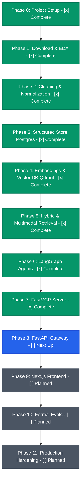
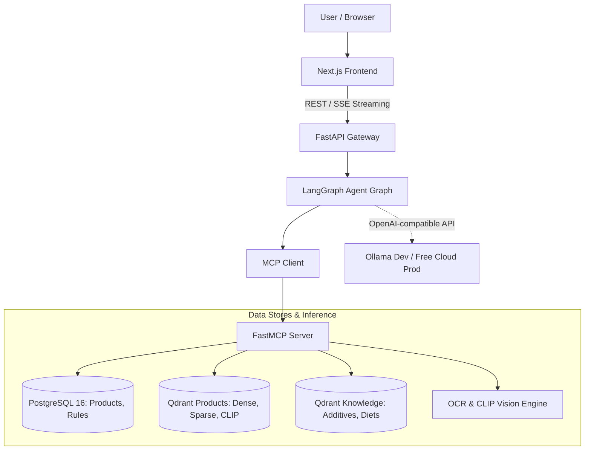
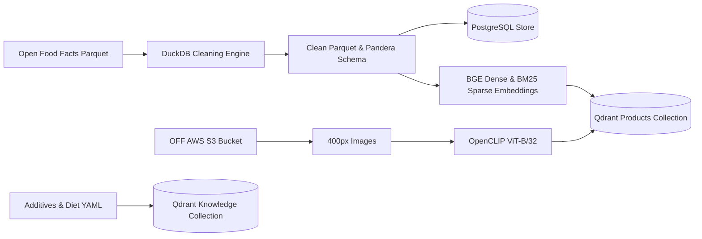

# LabelLens: Nutrition & Food Label Analyzer

*End-to-end project planner and learning guide · Working name: LabelLens · Updated Oct 12, 2026*

## 0. How to use this document

This is both a build plan and a study guide. Every phase has the same shape: **Goal → Concepts to learn → Steps → Deliverable (definition of done) → Checkpoint questions**. Work in order and do not start a phase until the previous deliverable is done.

Learning rule: hand-write the core pieces (data pipeline, embedding and retrieval code, the agent graph, the MCP tools). Use AI assistants for boilerplate, tests and debugging help, but make sure you can explain every core line. The checkpoint questions are how you verify that.

## 1. Project overview

**Problem.** Food labels are hard to read: long ingredient lists, E-numbers, allergen warnings, marketing claims. People with allergies, diets or health goals need fast, trustworthy answers.

**What LabelLens does**

- Identify a product from a barcode, a label photo, a product photo, or a typed name.
- Explain ingredients and additives in plain language, with sources.
- Check fit against a diet profile (vegan, vegetarian, gluten-free, lactose-free, nut-free, low sugar, low salt, palm-oil-free).
- Suggest better alternatives in the same category.
- Expose all of this as an MCP server so any MCP client can use the tools, not just your own UI.

**Skills this project demonstrates**

| Skill | Where it shows up |
| --- | --- |
| Agentic AI | LangGraph multi-agent graph with routing, parallel analysts, critic, human-in-the-loop |
| Multimodal RAG | Text + image (CLIP) + sparse retrieval over one product collection, fused and reranked |
| MCP server | FastMCP server with tools, resources and prompts; consumed by your own agent and external clients |
| Vector DB and embeddings | Qdrant with named vectors, payload filters, hybrid search |
| Orchestration and observability | LangGraph, plus LangSmith or Langfuse tracing |
| Full stack | FastAPI, Postgres, Next.js with barcode scanning and streaming chat |
| Production | Docker, CI/CD, evals, free-tier cloud deployment |

**Success criteria (write real numbers into the README when you have them)**

- Barcode lookup is exact and fast; text and image retrieval have measured Recall@1/5/10 and MRR on your own golden set.
- Allergen and diet answers come from structured data and rules, never from LLM guessing; 100% agreement with the source data on the allergen test set.
- Public demo deployed on free tiers, with CI, tests, tracing and a README that lets a stranger run it locally.

**Non-goals:** medical advice, scraping, paid APIs, storing personal health data on a server.

## 1.1 Phase Progress & Implementation Status



### Phase Milestone Checklist
- [x] **Phase 0 — Project setup (Week 1)**: uv, pyproject, Docker Compose (Postgres, Qdrant), healthchecks, CI tooling, Ollama smoke test.
- [x] **Phase 1 — Download and understand the data (Week 1–2)**: Open Food Facts Parquet, in-place DuckDB exploration, subset specification.
- [x] **Phase 2 — Cleaning and normalization (Week 2–3)**: GS1 barcode checksum validation, Pandera schema, clean Parquet (`products.parquet`).
- [x] **Phase 3 — Structured store in PostgreSQL (Week 3)**: SQLAlchemy 2 declarative models, Alembic migrations, streaming COPY loader, trigram fuzzy indexes.
- [x] **Phase 4 — Embeddings and the Vector Database (Week 3–5)**: Qdrant dual-collection setup, BGE dense, BM25 sparse, OpenCLIP image vectors, HNSW & INT8 scalar quantization benchmarks.
- [x] **Phase 5 — Retrieval: hybrid, multimodal, reranked (Week 5–6)**: Reciprocal Rank Fusion (RRF), cross-encoder reranker, multimodal router.
- [x] **Phase 6 — Agents with LangGraph (Week 6–8)**: Multi-agent supervisor, additive analyst, nutrition/diet analyst, critic, human-in-the-loop.
- [x] **Phase 7 — The MCP server (Week 8)**: FastMCP server exposing tools, resources, and prompt templates behind stdio and Streamable HTTP.
- [ ] **Phase 8 — API gateway with FastAPI (Week 8–9)**: Async API, SSE streaming chat, CORS, Pydantic v2 schemas.
- [ ] **Phase 9 — Frontend with Next.js (Week 9–10)**: Mobile-responsive UI, camera barcode scanning, live streaming chat.
- [ ] **Phase 10 — Evaluation (continuous, formalized in Week 10)**: Golden evaluation datasets, allergen detection accuracy, retrieval recall/MRR.
- [ ] **Phase 11 — Production hardening and free deployment (Week 10–11)**: Multi-stage Docker, GitHub Container Registry, cloud deployment on free tiers.

## 2. Architecture

### 2.1 Online System Architecture



### 2.2 Offline Data & Embedding Pipeline



**Design principles**

1. **Deterministic first, LLM second.** Barcode lookup, allergen matching and diet flags are SQL and rules. The LLM only explains and orchestrates.
2. **Provider-agnostic LLM.** One OpenAI-compatible client; model and base URL come from environment variables.
3. **Everything through MCP tools.** The same tools serve the agent, the API and external clients.
4. **Measure before tuning.** No change to chunking, models or prompts without an eval number before and after.
5. **Free tiers shape the data size.** Build a curated subset, not the whole database.

**Tech stack (all free / open source)**

| Layer | Tool | Why |
| --- | --- | --- |
| Language / packaging | Python 3.12, uv | Fast, reproducible environments |
| Data processing | DuckDB, Pandas/Polars, Pandera | Query Parquet directly; validate schemas |
| Relational DB | PostgreSQL 16, SQLAlchemy 2, Alembic | Structured product data, users, migrations |
| Vector DB | Qdrant | Named vectors (text and image in one point), sparse vectors, payload filters |
| Embeddings | Sentence-Transformers (BGE), OpenCLIP, FastEmbed BM25 | Dense text, image, sparse keyword |
| LLM runtime | Ollama (dev) | Local, free, OpenAI-compatible API |
| Agents | LangGraph, LangChain core, langchain-mcp-adapters | Stateful graphs, checkpoints, interrupts |
| MCP | FastMCP | Fast way to build MCP tools/resources/prompts |
| Observability | LangSmith free tier or self-hosted Langfuse | Traces for agent debugging and evals |
| API | FastAPI, Pydantic v2, SSE streaming | Typed, async, familiar to you |
| Frontend | Next.js, Tailwind, shadcn/ui, zxing (barcode) | Camera barcode scanning in browser |
| DevOps | Docker, Compose, GitHub Actions, GHCR | CI/CD and images, free for public repos |

## 3. Model selection

| Role | Default pick | Lighter option | Notes |
| --- | --- | --- | --- |
| Chat + tool-calling LLM | Qwen3 8B, 4-bit quantized (Ollama) | Qwen3 4B | Strong tool calling, permissive open license, good quality for its size |
| Text embeddings | BAAI/bge-small-en-v1.5 (384-d) | all-MiniLM-L6-v2 | Benchmark against bge-base-en-v1.5 (768-d) in Phase 4 |
| Image embeddings | OpenCLIP ViT-B/32 (512-d) | — | Visual similarity and text-to-image search |
| Sparse / keyword | BM25 via FastEmbed | — | Exact names, brands, E-numbers |
| Reranker | bge-reranker-base cross-encoder | skip | Run only on top-20 candidates |
| OCR | PaddleOCR or EasyOCR | Tesseract | Compare all three on label photos |
| Optional vision-language model | Qwen2.5-VL or Gemma 3 (small) via Ollama | — | Stretch goal: compare against OCR |

**Why this combination.** Consumer-grade hardware can run a 4-bit 7–8B model, and the quantized model keeps the whole stack runnable for open-source contributors. OCR + CLIP is cheaper, more deterministic and easier to evaluate than sending every photo to a vision-language model.

**Rules for working with small local models**

- Never hard-code a model name. Use `LLM_MODEL` and `LLM_BASE_URL`. Before you start, check the Ollama library for newer small tool-calling models; switching is one env var plus a rerun of your evals.
- Low temperature (0.1–0.3) for analysis; structured outputs via Pydantic or JSON schema.
- Give each agent at most about six tools; small models get confused by long tool lists.
- Keep prompts short, keep context around 8k tokens, and put retrieved evidence in a compact format.
- Anything safety-relevant (allergens, diet verdicts) is computed outside the LLM.

## 4. Phase 0 — Project setup (Week 1) [x] Complete

**Goal.** A repo where one command starts the infrastructure, tests run, CI is green and the LLM answers.

**Concepts.** Python packaging with uv and pyproject, virtual environments, Docker and Compose networking and volumes, 12-factor configuration, pre-commit hooks, trunk-based Git with small PRs.

**Steps**

1. Install: Git, Python 3.12, uv, Docker Desktop (WSL2 backend on Windows), Node 20+ LTS, VS Code, Ollama.
2. Create the repo with the layout below, a `.gitignore` that excludes `data/` and `.env`, and an MIT license for your code.
3. Write `docker-compose.yml` for Postgres 16 and Qdrant with named volumes; add healthchecks.
4. Add configuration with `pydantic-settings` and an `.env.example` (DB URL, Qdrant URL, LLM base URL and model, embedding model names).
5. Add quality tooling: ruff, pyright or mypy, pytest, pre-commit, and a GitHub Actions workflow that runs lint, types and tests.
6. Pull the model with Ollama and write a 10-line smoke test using the OpenAI-compatible client against `http://localhost:11434/v1`.

```
labellens/
├─ apps/
│  ├─ api/            # FastAPI gateway
│  ├─ mcp_server/     # FastMCP server
│  └─ web/            # Next.js frontend
├─ packages/labellens/ # shared Python package
│  ├─ config.py
│  ├─ data/           # download, clean, load
│  ├─ embeddings/     # text, image, sparse
│  ├─ retrieval/      # qdrant, hybrid, rerank
│  ├─ agents/         # graph, nodes, prompts
│  ├─ db/             # models, alembic
│  └─ llm/            # provider abstraction
├─ data/              # gitignored: raw/ interim/ clean/ images/
├─ notebooks/         # EDA and experiments
├─ evals/             # golden sets and metric scripts
├─ infra/             # Dockerfiles, CI, deploy
├─ docs/
└─ pyproject.toml, docker-compose.yml, .env.example, README.md
```

**Deliverable.** `docker compose up -d` starts Postgres and Qdrant healthy; `pytest` passes; CI is green; the smoke test prints a model reply.

**Checkpoint questions.** What is the difference between a Docker image, container and volume? Why keep config in environment variables? What does uv lock give you that a plain requirements file does not?

## 5. Phase 1 — Download and understand the data (Week 1–2) [x] Complete

**Goal.** Raw data on disk, understood, with a written decision about which subset you will use.

**Concepts.** Columnar formats (Parquet), nested types, querying files in place with DuckDB, data profiling, open-data licensing (ODbL).

**Sources (bulk exports, no scraping)**

- **Parquet export on Hugging Face:** dataset `openfoodfacts/product-database`, file `food.parquet`. Best starting point (compact and fast to query).
- **CSV export:** `https://static.openfoodfacts.org/data/en.openfoodfacts.org.products.csv.gz`.
- **JSONL dump** (same content as the MongoDB export) and a **delta export** for incremental updates.
- **Image export** through the AWS Open Data Program (anonymous access) or direct download.
- **Taxonomies** (ingredients, additives, allergens, categories, labels) in the `openfoodfacts-server` GitHub repository.

Verify current file names and sizes on the Open Food Facts data page before downloading; the Parquet file is several GB.

**License.** The database is under ODbL and images are CC BY-SA. You must attribute Open Food Facts and link to product pages. If you publish a database derived from theirs, share-alike applies. Simplest path: publish code under MIT, keep derived data out of the repo, and publish the pipeline that rebuilds it.

**Steps**

1. Download `food.parquet` into `data/raw/` (use `huggingface_hub` or curl) and record the checksum and date.
2. Explore with DuckDB without loading everything into memory:

```python
import duckdb

con = duckdb.connect()
con.sql("DESCRIBE SELECT * FROM 'data/raw/food.parquet'").show()
con.sql("""
  SELECT count(*) AS total,
         count(product_name) AS has_name,
         count(ingredients_text) AS has_ingredients
  FROM 'data/raw/food.parquet'
""").show()
```

3. Profile: null rate per column, products per country, completeness distribution, ingredient language, how many have images and full nutrition.
4. Note the schema carefully: some fields such as product name and ingredients text may be nested lists of language and text pairs. Check with `DESCRIBE` and handle them explicitly.
5. Write `notebooks/01_eda.ipynb` and a `docs/data_dictionary.md` listing each column you will use: `code`, name, brands, categories tags, ingredients text, allergens and traces tags, additives tags, ingredient-analysis tags (vegan, vegetarian, palm-oil), nutriments, Nutri-Score, NOVA group, Eco-Score, quantity, images, completeness.
6. Decide the subset rule. Suggested starting point: valid barcode, name present, ingredients present, core nutrients present (energy, fat, saturated fat, carbohydrates, sugars, protein, salt), at least one front image, a focus set of countries, then keep the most complete 100k–300k products.
7. Images: download only the front image at about 400 px for the subset. Do it in polite batches with retries and resume support, from the bulk export route rather than crawling.

**Deliverable.** Raw data downloaded, EDA notebook, data dictionary, written subset specification with row counts.

**Checkpoint questions.** Why is Parquet faster than CSV for this? What does ODbL require of you? How many products survive each subset rule, and which rule removes the most?

## 6. Phase 2 — Cleaning and normalization (Week 2–3) [x] Complete

**Goal.** A reproducible pipeline that turns raw data into one clean, validated Parquet file plus a data-quality report.

**Concepts.** Data quality dimensions (completeness, validity, consistency, uniqueness), idempotent pipelines, taxonomy mapping, three-valued logic (yes / no / unknown), validation with Pandera.

**Pipeline stages.** Each stage reads one Parquet and writes the next (`raw → interim → clean`), and `make clean` reruns everything.

1. **Extract.** Select needed columns and flatten nested language fields (prefer English).
2. **Filter.** Apply the subset rule from Phase 1 and log rows removed per rule.
3. **Normalize text.** Unicode NFKC, collapse whitespace, strip markup. Keep the original string for display and a lowercase copy for matching.
4. **Deduplicate.** By `code`; then near-duplicates (same brand, name and quantity) keeping the most complete record.
5. **Validate barcodes.** Length 8, 12, 13 or 14 plus GS1 checksum:

```python
def gs1_valid(code: str) -> bool:
    if not code.isdigit() or len(code) not in (8, 12, 13, 14):
        return False
    digits = [int(c) for c in code]
    check = digits.pop()
    total = sum(d * (3 if i % 2 == 0 else 1) for i, d in enumerate(reversed(digits)))
    return (10 - total % 10) % 10 == check
```

6. **Nutrition sanity.** Use per-100g values only. Check bounds (macros between 0 and 100 g), saturated fat not above total fat, sugars not above carbohydrates, salt approximately 2.5 times sodium, macros not summing far above 100 g. Flag or null invalid values and record a `quality_flags` list. Never silently correct.
7. **Ingredients.** Use the structured ingredients data when present; otherwise split on commas while respecting parentheses; extract percentages; map to taxonomy IDs where possible.
8. **Additives, allergens, traces.** Use the tags; map E-numbers to names through the additives taxonomy.
9. **Diet flags.** Derive vegan and vegetarian from the ingredient-analysis tags, and gluten, lactose, nuts and so on from allergen tags plus your own ingredient rules. Store each flag as `yes`, `no` or `unknown`. Unknown must stay unknown, because telling someone a product is safe when the data is missing is the worst failure of this app.
10. **Scores.** Keep Nutri-Score, NOVA and Eco-Score as given.
11. **Build `search_text`.** One readable product card per item, for example: name, brand, category, ingredients, allergens, additives, scores and key nutrition per 100 g.
12. **Validate and report.** Pandera schema checks; produce a report with rows in and out per stage, null rates and flag counts.

**Deliverable.** `data/clean/products.parquet` is rebuilt by one command, covered by unit tests (barcode and nutrition validators at minimum), with a data-quality report committed to `docs/`.

**Checkpoint questions.** Why do we keep `unknown` instead of defaulting to `no`? What happens if you run the pipeline twice? Which cleaning rule changed the most rows, and was that expected?

## 7. Phase 3 — Structured store in PostgreSQL (Week 3) [x] Complete

**Goal.** Clean data loaded into Postgres with a small, tested data-access layer. Postgres answers exact questions (barcode, filters, joins); Qdrant answers fuzzy ones.

**Concepts.** Relational modeling versus JSONB, primary and foreign keys, indexes (B-tree, GIN, trigram), migrations, bulk loading with COPY, repository pattern.

**Suggested schema**

| Table | Key columns |
| --- | --- |
| `products` | `code` (PK), name, brand, quantity, categories (array), ingredients\_text, nutriscore, nova, ecoscore, completeness, image\_path, off\_url, quality\_flags, search\_text |
| `nutrition` | `code` (FK), energy\_kcal, fat\_g, sat\_fat\_g, carbs\_g, sugars\_g, fiber\_g, protein\_g, salt\_g (all per 100 g) |
| `additives` | `id` (e.g. en:e322), name, e\_number, short description |
| `product_additives` | `code`, `additive_id` |
| `product_allergens` | `code`, allergen, kind (`contains` or `traces`) |
| `diet_flags` | `code`, diet, value (`yes`, `no`, `unknown`) |
| `users`, `profiles` | user id, diets, allergens, goals |
| `chat_sessions` | thread id, user id, created\_at |

Add a trigram (`pg_trgm`) GIN index on name and brand for typo-tolerant lookup, a GIN index on categories, and B-tree indexes on Nutri-Score and NOVA.

**Steps**

1. Define SQLAlchemy 2 models and generate the first Alembic migration; never edit the schema by hand.
2. Bulk load from the clean Parquet using COPY (via psycopg) or batched inserts; time both and note the difference.
3. Write repository functions: `get_by_code`, `fuzzy_search_name`, `filter_products`, `get_additives(code)`, `get_profile(user_id)`.
4. Test them against a real Postgres from Compose (or testcontainers), not mocks.
5. Run `EXPLAIN ANALYZE` on your three most common queries and confirm the indexes are used.

**Deliverable.** `alembic upgrade head` plus `make load` gives a populated database; repository tests pass; barcode lookup under about 10 ms locally.

**Checkpoint questions.** When would you pick JSONB over a normalized table? Why does a barcode lookup need no vector search? What does the trigram index buy you over `ILIKE`?

## 8. Phase 4 — Embeddings and the Vector Database (Week 3–5) [x] Complete

**Project:** LabelLens, Nutrition & Food Label Analyzer

## Goal

Two Qdrant collections: `products` (text, image and sparse vectors per product) and `knowledge` (explanation cards for additives, ingredients and diet rules). Text and sparse vectors are indexed first. Image vectors are added in a second pass once the images are downloaded.

## Concepts

What an embedding is, cosine similarity versus dot product, vector normalization, approximate nearest neighbor with HNSW (parameters `m`, `ef_construct`, `ef`), named vectors, payload indexes and pre-filtering, quantization, dense versus sparse retrieval, how CLIP puts text and images in one space, batch inference, resumable and idempotent jobs.

## Steps

### 1. Embedder interfaces

Write `TextEmbedder`, `ImageEmbedder` and `SparseEmbedder` classes with an `embed(batch)` method, so models can be swapped and compared. Normalize vectors and cache results on disk by content hash.

### 2. Text embeddings

Embed each product's `search_text`. For BGE query-time embeddings, test with and without the recommended retrieval instruction prefix and keep what scores better. Also generate the BM25 sparse vectors in this step.

### 3. Create the collections

One point per product with named vectors, and payload for filtering. Create all named vectors now, including `image_clip`. The image vectors can stay empty until step 6.

```python
from qdrant_client import QdrantClient, models

client = QdrantClient(url=settings.qdrant_url)
client.create_collection(
    collection_name="products",
    vectors_config={
        "text_dense": models.VectorParams(size=384, distance=models.Distance.COSINE),
        "image_clip": models.VectorParams(size=512, distance=models.Distance.COSINE),
    },
    sparse_vectors_config={"bm25": models.SparseVectorParams(modifier=models.Modifier.IDF)},
)
for field in [
    "nutriscore",
    "nova",
    "categories",
    "allergens",
    "diet_vegan",
    "diet_vegetarian",
    "diet_gluten_free",
    "has_image",
]:
    client.create_payload_index(
        "products", field_name=field, field_schema=models.PayloadSchemaType.KEYWORD
    )
```

Check the qdrant-client docs for the exact current API; the idea matters more than the syntax.

### 4. Index text and sparse vectors (pass 1)

Use a deterministic point ID (UUID5 of the barcode), upsert in batches of 256–1000, and make the job safe to rerun. Set `has_image = "false"` in the payload for now. You can already test text search at this point.

### 5. Download the images

Use the Open Food Facts image dataset on AWS (a public S3 bucket, no account needed), not the product pages, and do not crawl.

1. Download the key index, which lists every object in the bucket:

   ```bash
   wget https://openfoodfacts-images.s3.eu-west-3.amazonaws.com/data/data_keys.gz -P data/raw/
   ```

2. Convert each barcode to its folder prefix. Zero-pad to 13 digits, then split (unit-test this on a few products):

   ```python
   def key_prefix(code: str) -> str:
       c = code.zfill(13)
       return f"data/{c[0:3]}/{c[3:6]}/{c[6:9]}/{c[9:]}/"
   ```

3. In DuckDB, join your subset's prefixes with `data_keys.gz`, keeping only the 400 px versions (`.400.jpg`).
4. Inspect the real keys for about 5 products before writing the selection rule. Prefer a `front_*.400.jpg` image, otherwise fall back to the lowest numeric image. Log how many products fall into each case and how many have no image.
5. Download concurrently (8–16 workers) with retries, skip files that already exist, verify each file opens as an image, and write `data/images/manifest.parquet` (code, source key, status, bytes). Start with a pilot of about 5,000 images, then scale up.
6. Images sync monthly, so a few products may have none. Keep them in the text index and leave `has_image = "false"`.

Reference: `https://openfoodfacts.github.io/documentation/docs/Product-Opener/api/aws-images-dataset/`

Images are licensed CC BY-SA, so keep the Open Food Facts attribution in your README and UI.

### 6. Image embeddings (pass 2)

Run OpenCLIP over the downloaded images in batches of 32–64 (half precision on GPU). Save vectors to Parquet shards so the job is resumable. This is the slowest step, so embed the pilot first, evaluate, then scale up. Attach the vectors to the existing points without re-indexing everything:

```python
client.update_vectors(
    collection_name="products",
    points=[
        models.PointVectors(id=point_id, vector={"image_clip": vec}) for point_id, vec in batch
    ],
)
client.set_payload("products", payload={"has_image": "true"}, points=[p for p, _ in batch])
```

Again, confirm the exact calls in the current qdrant-client docs.

### 7. Build the `knowledge` collection

Sources:

- Names, synonyms and parent relations from the Open Food Facts taxonomies.
- Short notes you write for the 100 most common additives: what it is, why it is used, regulatory status, with a source link to public EFSA, WHO or FDA pages.
- Diet rules: what vegan, vegetarian and gluten-free mean, and common hidden sources (for example carmine E120, gelatin, whey, and E471 which may be animal or plant).

Every card keeps a `source_url`. Chunk to about 200–400 tokens.

### 8. Learning experiments

Record results in a table:

| Experiment | What to compare |
|---|---|
| Model size | bge-small versus bge-base |
| Document format | with and without the product card format |
| HNSW search | `ef` versus latency and recall |
| Quantization | scalar quantization versus memory and recall |
| Image coverage | text-to-image search quality on the pilot versus the full image set |

## Deliverable

- Both collections populated by `make index` (text pass) and `make index-images` (image pass).
- A download manifest for the images.
- A notebook with your experiment table and one paragraph on what you learned from each experiment.

## Checkpoint questions

1. Why normalize vectors for cosine search?
2. What does `ef` trade off?
3. Why does CLIP let a text query retrieve images?
4. Why must payload indexes exist before you rely on filters at scale?
5. Why is a two-pass index (text first, images later) safer than one big job?
## 9. Phase 5 — Retrieval: hybrid, multimodal, reranked (Week 5–6) [x] Complete

**Goal.** One `search()` interface that routes the five input types to the right retrieval path, with measured quality.

**Concepts.** Hybrid search, Reciprocal Rank Fusion (RRF), weighted late fusion, cross-encoder reranking, pre-filtering, query understanding, retrieval metrics (Recall@k, MRR, nDCG), ablation studies.

**Retrieval paths**

| Input | Path |
| --- | --- |
| Barcode | Exact lookup in Postgres (no vectors) |
| Typed query | Dense + BM25 prefetch in Qdrant, fused with RRF, optional rerank, optional diet filters |
| Product photo | CLIP image vector against `image_clip`; also supports text-to-image queries |
| Label photo | OCR → try to read a barcode and brand/name tokens → text hybrid search; combine with the CLIP score via weighted late fusion |
| Explanation need | Query the `knowledge` collection by additive or ingredient name |

Hybrid query with fusion and a filter:

```python
hits = client.query_points(
    collection_name="products",
    prefetch=[
        models.Prefetch(query=dense_vec, using="text_dense", limit=50),
        models.Prefetch(query=sparse_vec, using="bm25", limit=50),
    ],
    query=models.FusionQuery(fusion=models.Fusion.RRF),
    query_filter=models.Filter(
        must=[
            models.FieldCondition(key="diet_vegan", match=models.MatchValue(value="yes")),
        ]
    ),
    limit=10,
).points
```

Late fusion for label photos: `score = w_text * text_score + w_image * image_score`. Tune the weights on your eval set, not by feel.

**Build the golden set first.** About 150 typed queries (full names, brand only, misspellings, loose descriptions), about 50 photos (your own plus held-out images), each with the expected barcode. Store in `evals/` as JSONL.

**Ablation table to produce**

| Experiment | Compare |
| --- | --- |
| Text retrieval | dense only, BM25 only, hybrid, hybrid + reranker |
| Image retrieval | image only, OCR-text only, fusion |
| Filters | with and without diet pre-filters (latency and recall) |

**Deliverable.** A `retrieval` package with a single `search()` entry point, a script that prints the metrics table, and the ablation results saved to `docs/retrieval_results.md`.

**Checkpoint questions.** Why does hybrid beat dense alone on brand names and E-numbers? What does RRF do and why does it avoid score calibration problems? When is a reranker not worth its latency?

## 10. Phase 6 — Agents with LangGraph (Week 6–8) [x] Complete

**Goal.** A multi-agent graph that takes any input type and returns a grounded, cited, profile-aware answer.

**Concepts.** State machines, state reducers, conditional edges, parallel fan-out and fan-in, the tool-calling loop, checkpointing, human-in-the-loop interrupts, structured outputs, critic and guardrail patterns, tracing.

**Agent roster**

| Node | Job | Uses LLM? |
| --- | --- | --- |
| Router | Classify the request: barcode, text, photo, compare, alternatives, general question | Yes (small prompt) or rules |
| Product Identifier | Resolve to one product via the retrieval paths; ask the user to pick if ambiguous | Mostly no |
| Ingredient Analyst | Explain notable ingredients and flag ultra-processing markers, using `knowledge` evidence | Yes |
| Additive Analyst | Explain each additive, purpose and status, with sources | Yes |
| Diet Checker | Compute verdicts from rules and flags; the LLM only words the explanation | Rules first |
| Alternatives Finder | Vector search with filters for better Nutri-Score in the same category | Mostly no |
| Critic | Verify that claims are grounded, that verdicts match the rules, and that no medical claims slip in | Yes + checks |
| Synthesizer | Write the final answer for the user in plain language with citations | Yes |

**Graph topology**

```
START → router → identify ──(ambiguous)──► interrupt: user picks product
                    │
                    ▼
        ┌─ ingredient_analyst ─┐
        ├─ additive_analyst   ─┼─► join → alternatives (optional) → critic → synthesizer → END
        └─ diet_checker       ─┘                                   │
                                                         (fails) └─► revise once
```

**State sketch**

```python
class AgentState(TypedDict):
    messages: Annotated[list, add_messages]
    profile: dict  # diets, allergens, goals (loaded from Postgres)
    input_kind: str  # barcode | text | photo | compare | alternatives | qa
    product: dict | None
    evidence: Annotated[list, operator.add]  # each item has an id and source
    findings: dict  # per-analyst structured outputs
    verdicts: dict  # computed by rules, not by the LLM
    answer: str | None
```

**Prompting rules for every agent**

- Role, inputs and a Pydantic output schema; no free-form output between nodes.
- Use only the evidence provided; if it is missing, say unknown. Cite evidence IDs.
- Never give medical advice; never state an allergen or diet verdict that is not in `verdicts`.

**Steps**

1. **6a: plain Python tools first.** Implement the agents calling your retrieval and repository functions directly, and get all four scenarios working (barcode, text, photo, alternatives).
2. Add a checkpointer (SQLite in dev, Postgres in production) so conversations can resume by thread ID; load the user profile into state at the start.
3. Add the interrupt for ambiguous product matches and test the resume path.
4. Add the critic and one bounded revision loop (set a recursion limit).
5. Turn on tracing (LangSmith free tier or self-hosted Langfuse), tag runs with a version, and review the failed traces every week.
6. Handle failure: tool timeouts, retries, error messages the model can act on, and a safe fallback answer if the LLM is unavailable.

**Deliverable.** The graph runs from a CLI on all four scenarios with traces; a starter agent eval set of about 30 scenarios with expected verdicts exists in `evals/`.

**Checkpoint questions.** What is a reducer and why does `evidence` need one? Why compute verdicts outside the LLM? What would break if the critic were removed, and how would your evals show it?

## 11. Phase 7 — The MCP server (Week 8) [x] Complete

**Goal.** Your retrieval and data tools exposed through a Model Context Protocol server, consumed by your own agent and by any external MCP client.

**Concepts.** MCP architecture (host, client, server), the three primitives (tools, resources, prompts), transports (stdio for local, streamable HTTP for remote), JSON-RPC under the hood, schemas generated from type hints, tool descriptions as prompts, least-privilege and read-only design.

**Tools to expose**

| Tool | Input | Output |
| --- | --- | --- |
| `lookup_by_barcode` | barcode | product record or not-found object |
| `search_products` | query, optional filters, limit | ranked products with scores |
| `search_by_image` | image (path or base64), mode | candidate products with scores |
| `ocr_label` | image | extracted text, detected barcode, candidate name/brand |
| `get_nutrition` | barcode | per-100g values, scores, quality flags |
| `explain_additive` | E-number or name | knowledge card with source links |
| `check_diet_fit` | barcode, profile | per-diet verdict (yes / no / unknown) with reasons |
| `find_alternatives` | barcode, constraints | better products in the same category |
| `compare_products` | list of barcodes | side-by-side comparison |

**Resources:** `product://{code}`, `additive://{id}`. **Prompts:** `analyze_label`, `diet_audit`.

```python
from fastmcp import FastMCP

mcp = FastMCP("labellens")


@mcp.tool
def lookup_by_barcode(code: str) -> dict:
    """Return product details for a barcode, or an error object if not found."""
    return products_repo.get_by_code(code) or {"error": "not_found", "code": code}


if __name__ == "__main__":
    mcp.run()  # stdio by default; add an HTTP transport for deployment
```

**Steps**

1. Wrap each repository and retrieval function as a tool with a precise docstring (small models choose tools from descriptions, so wording matters).
2. Add the resources and prompts, then test everything with the MCP Inspector.
3. Connect from an external MCP client such as Claude Desktop through a stdio config entry, and try a real conversation.
4. Switch your LangGraph agent from direct Python calls to this server using `langchain-mcp-adapters`. The graph should not change; only the tool source does.
5. Add the streamable HTTP transport with bearer-token authentication for deployment.
6. Hardening: read-only database role, input validation, image size limits, per-token rate limits, no filesystem access from tools, structured error objects.
7. Write tool-level tests (call each tool with good, bad and empty inputs).

**Deliverable.** An MCP server that works from the Inspector, from an external client and from your agent, with tests and a short `docs/mcp.md` listing every tool.

**Checkpoint questions.** When is something a resource rather than a tool? Why does stdio not need authentication but HTTP does? What can go wrong if a tool description is vague?

## 12. Phase 8 — API gateway with FastAPI (Week 8–9) [ ] Next Up

**Goal.** A typed, streaming HTTP API in front of the agent graph.

**Concepts.** Async I/O, dependency injection, Pydantic v2 request/response models, Server-Sent Events, authentication, rate limiting, upload validation, health and readiness probes.

| Endpoint | Purpose |
| --- | --- |
| `POST /v1/analyze` | Multipart: image, barcode or text + profile → structured analysis |
| `POST /v1/chat` | SSE stream of agent tokens and events for a thread |
| `GET /v1/products/{code}` | Product details (cached) |
| `GET /v1/search` | Text search with filters |
| `POST /v1/feedback` | Thumbs up/down with trace ID (feeds your evals) |
| `GET /health`, `GET /ready` | Liveness and readiness (DB, Qdrant, LLM reachable) |

**Steps**

1. Define request and response schemas first; they become your OpenAPI contract and the frontend's types.
2. Implement streaming with SSE; emit events for node start, tool call, partial answer and final answer so the UI can show progress.
3. Validate uploads: allowed MIME types, size limit, decode check, strip EXIF metadata.
4. Add API-key or JWT authentication, CORS for the frontend origin, and rate limiting (for example slowapi).
5. Add an in-memory or Redis cache for product lookups; add request IDs to every log line and trace.
6. Write API tests with `httpx` and a fake LLM so they run fast and deterministically.

**Deliverable.** OpenAPI docs render, streaming works from curl, and API tests pass in CI.

**Checkpoint questions.** Why SSE instead of WebSockets here? What does readiness check that liveness does not? How do you test an endpoint that calls an LLM?

## 13. Phase 9 — Frontend with Next.js (Week 9–10) [ ] Planned

**Goal.** A clean, mobile-friendly UI that makes the system usable in a supermarket aisle.

**Screens**

- **Scan / Search:** camera barcode scanning in the browser (zxing), photo upload with preview, text search box.
- **Product page:** name, image, Nutri-Score and NOVA badges, nutrition table, ingredient list with highlighted additives, per-diet verdict chips (yes / no / unknown), alternatives list, and source and attribution footer.
- **Chat:** streaming conversation about the product, with expandable evidence and citations.
- **Profile:** diets, allergens, goals. Store it in the browser (localStorage) and send it per request, so no health preferences live on your server.

**Steps**

1. Generate a typed API client from the OpenAPI schema.
2. Build the scan flow first (it is the core user value), then product page, then chat.
3. Show streaming progress events (identifying product, checking additives, checking diet) so latency feels intentional.
4. Make unknown verdicts visually distinct from safe verdicts.
5. Accessibility basics (labels, contrast, keyboard use) and a Playwright end-to-end test for the main flow.

**Deliverable.** A deployed-ready frontend that completes barcode, photo and text flows against the API, with an end-to-end test.

**Checkpoint questions.** Why keep the profile client-side? How does the UI communicate uncertainty? What happens when the camera permission is denied?

## 14. Phase 10 — Evaluation (continuous, formalized in Week 10) [ ] Planned

**Goal.** Numbers you can put in the README and defend in an interview.

| Layer | What to measure | How |
| --- | --- | --- |
| Retrieval | Recall@1/5/10, MRR, nDCG per input type | Golden sets from Phase 5 |
| Rules | Allergen and diet verdict accuracy; zero unsafe false positives for `safe` | Unit tests plus comparison with the source ingredient-analysis tags |
| Agent | Task success, correct tool use, groundedness, refusal of medical advice | 30–50 scripted scenarios |
| LLM-as-judge | Faithfulness and answer quality | Local model as judge on a sample; spot-check by hand because small judges are biased |
| Performance | P50 and P95 latency per endpoint, tokens per request | Load script plus traces |

**Practices**

- Version every eval run (git SHA, model names, config) and store results in `evals/results/`.
- Run the fast layers (retrieval and rules, no LLM) on every pull request as a regression gate; run the LLM layers nightly or manually.
- Use user feedback from `/v1/feedback` to grow the golden set.
- Error analysis beats metric chasing: read 20 failures per round and categorize them.

**Deliverable.** `make eval` produces a results table; the README shows current numbers and the date they were measured.

## 15. Phase 11 — Production hardening and free deployment (Week 10–11) [ ] Planned

**Goal.** A public demo that stays up on free tiers, with the engineering practices a real service needs.

**Build and run**

1. Multi-stage Dockerfiles (small images, non-root user, pinned dependencies) for API, MCP server and web.
2. A production Compose file and a one-command local run for contributors.
3. Configuration only through environment variables; secrets never in the repo; `.env.example` stays current.
4. Structured JSON logging with request and trace IDs; basic metrics (request count, latency, tool errors).
5. Security pass: dependency scanning (for example `pip-audit`, `npm audit`), upload limits, rate limits, CORS allow-list, auth on MCP HTTP, read-only DB role.
6. CI/CD with GitHub Actions: lint, types, tests, fast evals, build and push images to GHCR, deploy on merge to main.

**Free deployment options.** Free tiers change often, so verify current limits before committing.

| Component | Option | Watch out for |
| --- | --- | --- |
| Frontend | Vercel Hobby or Cloudflare Pages | Non-commercial terms on some plans |
| API + MCP container | Hugging Face Spaces (Docker) or another free container host | Cold starts; memory limits (query-time embedding models need roughly 1–2 GB RAM) |
| Qdrant | Qdrant Cloud free cluster | Size cap; shrink the subset or use quantization to fit |
| Postgres | Neon or Supabase free tier | Storage cap; store only the subset and slim columns |
| LLM | A free API tier through your OpenAI-compatible client (Gemini, Groq or OpenRouter free models) | Rate limits; add retry with backoff and a fallback message |
| Tracing | LangSmith free tier or Langfuse hobby | Trace retention and volume limits |
| Fallback demo | Run on your own machine and expose through a Cloudflare Tunnel | Only available while the machine is on |

**Capacity check.** 100,000 products with 384-d text and 512-d image vectors is roughly 360 MB of raw float32 vectors before the index and payload, so a free cluster is realistic with quantization. Pick the final subset size from this arithmetic, not by guessing.

**LLM in production.** You cannot host an 8B model for free around the clock, so the production LLM is a free API tier behind the same client interface, while contributors can run Ollama locally. Document both paths in the README. Rerun your agent evals after any model swap.

**Deliverable.** A public URL, a green CI/CD pipeline, a rollback story (previous image tags), and a short `docs/runbook.md` (how to restart, re-index, rotate keys).

**Checkpoint questions.** What happens on a cold start and how does the UI handle it? Which single component would fail first under load and how would you know? How would you roll back a bad deploy?

## 16. Safety, legal and ethics

- **Not medical advice.** Show a short disclaimer on the product page and in chat. Never diagnose, never promise safety.
- **Allergens are data, not generation.** Allergen and diet verdicts come from structured fields and rules. If data is missing or the product has a quality flag, the verdict is `unknown`.
- **Crowd-sourced data can be wrong.** Show data completeness and last-modified date, and link to the Open Food Facts page so users can verify or correct it.
- **Attribution and licensing.** Credit Open Food Facts everywhere data appears; respect ODbL for the database and CC BY-SA for images; keep your own licenses clear in the README.
- **Privacy.** Profiles stay in the browser; do not log uploaded images or personal preferences; strip EXIF; state this in the README.
- **Responsible demo.** Rate-limit, and do not claim certification-level accuracy (for example for halal or kosher status) unless the data explicitly says so.

## 17. Timeline

| Week | Focus | Milestone | Status |
| :---: | --- | --- | :---: |
| 1 | Phase 0 setup, start Phase 1 | Repo, Compose, CI, LLM smoke test; data downloaded | [x] **Complete** |
| 2 | Phase 1 finish, Phase 2 | EDA notebook, subset spec, cleaning pipeline v1 | [x] **Complete** |
| 3 | Phase 2 finish, Phase 3 | Clean Parquet, Postgres loaded, repository tests | [x] **Complete** |
| 4–5 | Phase 4 | Embeddings and both Qdrant collections, experiments table | [x] **Complete** |
| 5–6 | Phase 5 | Hybrid and multimodal retrieval, golden set, ablations | [x] **Complete** |
| 6–8 | Phase 6 | LangGraph agents, tracing, agent scenarios | [ ] *Next Up* |
| 8 | Phase 7 | MCP server consumed by agent and external client | [ ] *Planned* |
| 8–9 | Phase 8 | Streaming API | [ ] *Planned* |
| 9–10 | Phase 9 | Frontend | [ ] *Planned* |
| 10 | Phase 10 | Evaluation report, README numbers | [ ] *Planned* |
| 10–11 | Phase 11 | Public deployment, runbook, demo video | [ ] *Planned* |

If you fall behind, cut scope in this order: optional VLM experiment, reranker, compare tool, alternatives agent, Playwright tests. Do not cut evaluation, the deterministic diet rules or the MCP server; those are what make the project stand out.

## 18. Risks and fixes

| Risk | Mitigation |
| --- | --- |
| Dataset too large to process | Query with DuckDB in place; process in shards; work from the subset |
| Image embedding takes too long | Resumable shards, start with a smaller subset, run overnight |
| Small LLM picks wrong tools or ignores schemas | Fewer tools per agent, tighter prompts, structured outputs, lower temperature, deterministic nodes |
| Free LLM API rate limits | Retries with backoff, caching, provider fallback, shorter prompts |
| Poor OCR on curved packaging | Compare OCR engines, preprocess (crop, deskew, contrast), fall back to barcode and CLIP |
| Free-tier storage caps | Smaller subset, quantization, slim payload, on-disk vectors |
| Scope creep | Follow the cut order above; one feature per branch with an eval before merging |

## 19. GitHub README outline

1. Title, one-line pitch, demo GIF, live demo link.
2. What it does and architecture diagram.
3. **Requirements:** tested on Windows 11; 16 GB+ RAM recommended; Docker, Python 3.12 and Node 20+; GPU optional (speeds up local models and image embedding); runs fully free and offline-capable with Ollama.
4. Quick start (clone, `.env`, `docker compose up`, `make data`, `make index`, run).
5. Data: source, license, attribution, how the subset is built.
6. Models used and how to swap them.
7. MCP server: tool list and Claude Desktop config example.
8. Evaluation results table with date and config.
9. Project structure, testing, contributing.
10. Limitations, disclaimer, license.

## 20. Resume bullets (fill in real numbers later)

- Built an agentic nutrition-label analyzer on 150k+ Open Food Facts products: LangGraph multi-agent pipeline with rule-based allergen/diet verdicts, critic node and human-in-the-loop product disambiguation.
- Implemented multimodal hybrid retrieval in Qdrant (BGE dense + BM25 sparse + OpenCLIP image vectors, RRF fusion, cross-encoder rerank), reaching Recall@5 of \[X\]% on a \[N\]-query golden set.
- Designed and published a FastMCP server with \[N\] tools consumed by a LangGraph agent and external MCP clients; added token auth and read-only data access.
- Shipped a FastAPI + Next.js app with SSE streaming and in-browser barcode scanning; CI/CD on GitHub Actions; deployed on free tiers with P95 latency of \[X\] s.
- Established an evaluation harness (retrieval, rules, agent, LLM-judge) that gates pull requests on regression.

## 21. Learning resources by phase

- **Data:** Open Food Facts wiki and data page; the Open Food Facts blog post on exploring the database with DuckDB; DuckDB documentation.
- **Embeddings and vector search:** Qdrant documentation and tutorials (hybrid search, named vectors, quantization); Sentence-Transformers docs; OpenCLIP README; MTEB leaderboard for embedding choices.
- **RAG:** LangChain's RAG-from-scratch material; Hamel Husain's writing on evals.
- **Agents:** LangGraph documentation and tutorials (multi-agent, human-in-the-loop, persistence); LangSmith or Langfuse docs.
- **MCP:** the official MCP specification and docs; FastMCP documentation; the MCP Inspector.
- **Backend and DevOps:** FastAPI docs (async, SSE), SQLAlchemy 2 and Alembic docs, Docker multi-stage build guide, GitHub Actions docs.

## 22. Final definition of done

- [ ] Clean data pipeline reproducible with one command and a data-quality report
- [ ] Postgres and Qdrant populated by scripted jobs
- [ ] Hybrid + multimodal retrieval with ablation results
- [ ] LangGraph agents with tracing, critic and interrupt
- [ ] MCP server usable from an external client
- [ ] Streaming API, frontend and end-to-end test
- [ ] Evaluation report with real numbers in the README
- [ ] Public deployment on free tiers, CI/CD, runbook
- [ ] README, license and Open Food Facts attribution complete
- [ ] A 2–3 minute demo video and a short write-up of what you learned
